# Dose Engine — Route 1

[](https://github.com/deeyeti/dose-newsletter/actions/workflows/ci.yml)
[](https://nodejs.org/)
[-black.svg)](https://nextjs.org/)
[](LICENSE)

A local-first, human-in-the-loop newsletter generation engine. A Frame.io interview video automatically triggers speech-to-text transcription, an AI-drafted newsletter adhering to Dose of Society editorial standards, an interactive review dashboard with real-time preview, and single-click idempotent delivery via Resend. **Nothing is emailed automatically.**

---

## Architecture Flow

```mermaid
flowchart LR
    A[Frame.io V4\nfile.ready] -->|HMAC-SHA256 Webhook| B[Next.js Webhook\nReceiver]
    B -->|Event Deduplication| C[(SQLite Local DB)]
    B -->|Async Job| D[FFprobe Guard\n< 90s Duration]
    D -->|FFmpeg Extract| E[16 kHz Mono FLAC]
    E -->|Groq API| F[Whisper Turbo\nTranscription]
    F -->|Anthropic API| G[Claude Opus / Sonnet\nJSON Draft Generator]
    G -->|Persist Draft| C
    C -->|Real-time Poll| H[Editorial Review UI]
    H -->|Human Approval| I[Resend Email API]
    I -->|Provider ID Lock| C
```



---

## Features

- **Frame.io V4 Integration**:
  - `file.ready` webhook listener with constant-time HMAC-SHA256 verification and 5-minute replay window guard.
  - Automatic event deduplication and asset idempotency.
  - Manual folder scanning for newest uploads in a configured `FRAMEIO_FOLDER_ID`.
- **Audio Extraction & Safety Guards**:
  - FFprobe duration guard (strict 90-second limit).
  - FFmpeg 16 kHz mono FLAC extraction with immediate temporary file cleanup in OS temp directories.
- **Speech-to-Text Transcription**:
  - Groq `whisper-large-v3-turbo` with payload threshold verification (< 25 MB).
- **Editorial AI Drafting**:
  - Anthropic Messages API using Claude Opus (`claude-3-opus-20240229`) or Claude 3.5 Sonnet.
  - Strict Dose of Society human-interest editorial constraints: grounded facts only, verbatim quotes, and zero AI hallucination.
  - Support for workspace-scoped keys or user keys with `ANTHROPIC_WORKSPACE_ID`.
- **Editorial Review Dashboard**:
  - Next.js 16 App Router UI with real-time status tracker, event log, and draft editor.
  - Interactive email preview modal with subject, preview text, headline, and body.
  - Built-in **Sample Mode** to preview and test the editorial workflow with zero API calls.
- **Secure Email Delivery**:
  - Resend email provider with send idempotency locking to prevent duplicate broadcasts.
- **CI/CD & Releases**:
  - GitHub Actions CI workflow covering ESLint, unit/integration test suites, and Next.js production builds.
  - GitHub Actions Release pipeline automating versioned releases and changelog extraction.

---

## Prerequisites

1. **Node.js 24+** (utilizes native `node:sqlite`).
2. **FFmpeg & FFprobe** on `PATH`:
   ```powershell
   # Windows (via winget)
   winget install Gyan.FFmpeg
   ```
3. **ngrok** (for local webhook testing):
   ```powershell
   ngrok config add-authtoken <YOUR_AUTHTOKEN>
   ngrok http 3000
   ```

---

## Getting Started

### 1. Clone & Install

```bash
git clone https://github.com/deeyeti/dose-newsletter.git
cd dose-newsletter
npm install
```

### 2. Configure Environment

Copy `.env.example` to `local.env` (or `.env.local`):

```bash
cp .env.example local.env
```

Fill in your provider credentials:

| Variable | Description |
| --- | --- |
| `ANTHROPIC_API_KEY` | Anthropic API key (`sk-ant-api...` or `sk-ant-usr...`) |
| `CLAUDE_MODEL` | Claude model ID (`claude-3-opus-20240229` or `claude-3-5-sonnet-20241022`) |
| `ANTHROPIC_WORKSPACE_ID` | Optional: Workspace ID (`wrkspc_...`) required only for user keys |
| `GROQ_API_KEY` | Groq API key (`gsk_...`) |
| `GROQ_TRANSCRIPTION_MODEL` | `whisper-large-v3-turbo` (default) or `whisper-large-v3` |
| `FRAMEIO_ACCESS_TOKEN` | Adobe/Frame.io V4 OAuth Bearer token |
| `FRAMEIO_ACCOUNT_ID` | Frame.io Account UUID |
| `FRAMEIO_PROJECT_ID` | Target Frame.io Project ID |
| `FRAMEIO_FOLDER_ID` | Target Frame.io Folder ID |
| `FRAMEIO_WEBHOOK_SECRET` | Secret provided when registering the Frame.io webhook |
| `EMAIL_PROVIDER` | `resend` |
| `EMAIL_API_KEY` | Resend API key (`re_...`) |
| `EMAIL_FROM` | Verified sender address (e.g. `onboarding@resend.dev` or custom domain) |
| `DEMO_RECIPIENT_EMAIL` | Default recipient email address for testing |
| `PUBLIC_BASE_URL` | Public HTTPS host URL (e.g. ngrok tunnel URL) |

> [!CAUTION]
> Never commit `local.env`, `.env.local`, or `.data/` to version control. They are strictly excluded by `.gitignore`.

### 3. Run Development Server

```bash
npm run dev
```

Open [http://localhost:3000](http://localhost:3000) in your browser. Click **Create sample** to test the entire editorial flow with mock data.

---

## Webhook Setup (Frame.io V4)

1. Start your local dev server and ngrok tunnel:
   ```bash
   ngrok http 3000
   ```
2. In the Frame.io Developer Console / Adobe Developer Portal, register a new webhook with:
   - **Event**: `file.ready`
   - **URL**: `https://<YOUR-NGROK-SUBDOMAIN>.ngrok-free.dev/api/webhooks/frameio`
3. Copy the webhook signing secret returned upon creation into `FRAMEIO_WEBHOOK_SECRET` in `local.env`.

---

## Testing & Validation

```bash
# Run ESLint
npm run lint

# Run unit and integration tests
npm test

# Verify production build
npm run build
```

---

## CI/CD & Version Control

- **Continuous Integration (`.github/workflows/ci.yml`)**: Automatically triggers on pushes and pull requests to `main` to run linter checks, test suites, and build validation.
- **Releases (`.github/workflows/release.yml`)**: Automatically triggered on semver tags (`v*.*.*`) or via manual workflow dispatch. Extracts patch notes from [`CHANGELOG.md`](CHANGELOG.md) and creates a tagged GitHub Release with release artifacts.

To cut a new release:
```bash
git tag v0.1.0
git push origin v0.1.0
```

---

## License

MIT
